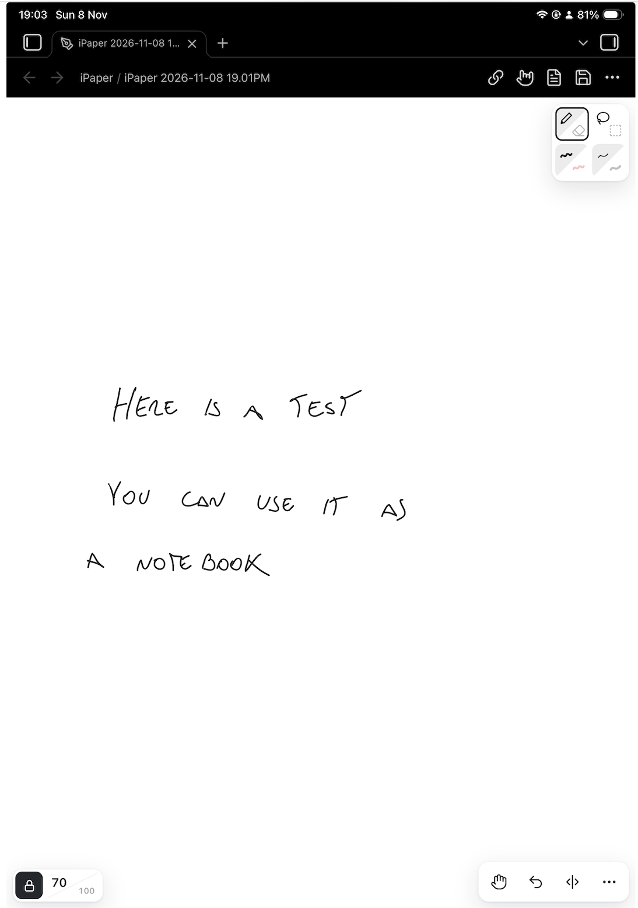
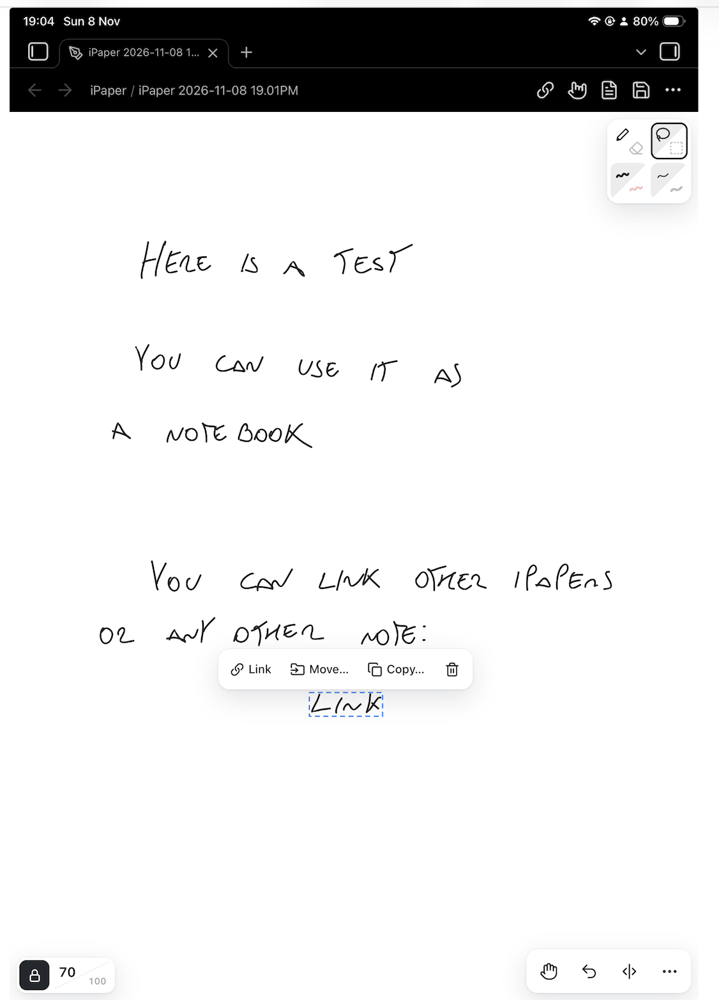
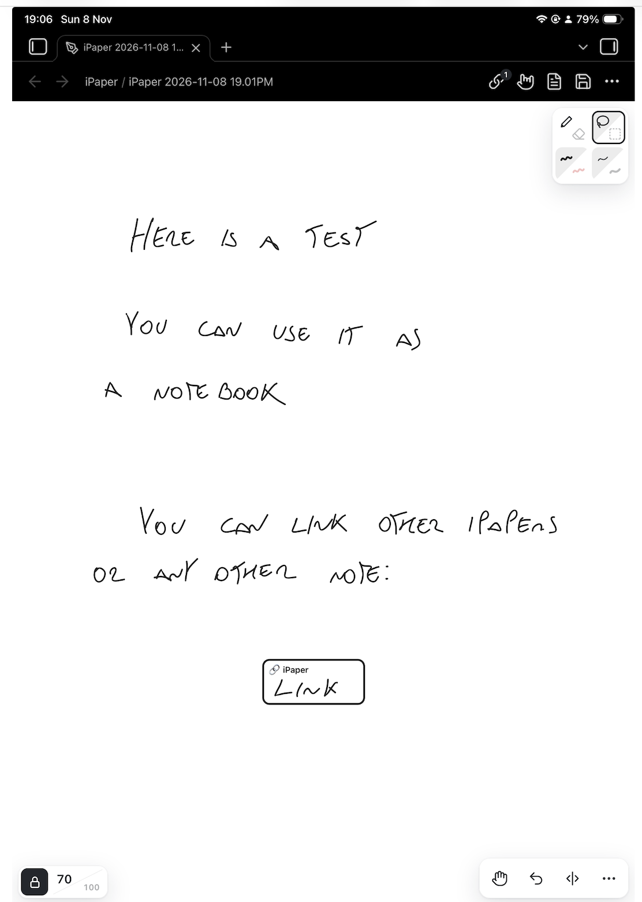

# Infinite Paper

**An infinite canvas for handwriting in Obsidian.** Handwrite your notes on an endless white page, like a notebook for studying and class notes. Made for **iPad and other tablets, ideally with a pen** such as Apple Pencil.

<p align="center">
  
  
  
</p>

## Why

- **Smooth handwriting, like tldraw.** The goal was handwriting that feels as smooth as the [tldraw plugin](https://github.com/tldraw/obsidian-plugin), which is smoother than whiteboard plugins such as Excalidraw.
- **Write a whole notebook on one page.** The tldraw plugin stops at 4,000 strokes per page. Infinite Paper was tested on an iPad with 500,000 and still pans and zooms smoothly. As a rough guide, a full handwritten page is about 1,400 strokes (25 lines × 8 words × about 7 strokes per word, measured on real handwriting), so that's about 3 pages against about 350.
- **Links between notes, and moving your handwriting between pages.** Link boxes on the page are real Obsidian links, so backlinks, the graph and renames just work. Select some handwriting and move or copy it to another drawing; a link to its new place stays behind.
- **A drawing is a note, not a new file type.** Some handwriting plugins keep ink in their own file format, outside your notes. Infinite Paper saves each drawing as a regular `.md` note, so it behaves like any other note: you can add tags, properties and links at the top, find it by name, and see it in backlinks and the graph. If you ever turn the plugin off, your drawings are still ordinary notes. Your header text and links stay readable, and nothing is locked in a separate format.
- **Simple on purpose.** Two colors, four pen sizes and only a few buttons, so the screen stays out of the way while you write. There are no shapes, text boxes or sticky notes; for those, use tldraw or Excalidraw.

## Features

- **Pen and eraser, black and red, four sizes.** Even-width handwriting, smoothed with [perfect-freehand](https://github.com/steveruizok/perfect-freehand).
- **Palm guards.** Only the pen draws, so your hand can rest on the screen. A resting palm doesn't scroll the page, and a touch that lands as the pen lifts is ignored. Turn the guard off from the header if you want your finger to draw. Optional **pen mode**: once the pen touches the page, one finger stops moving it, and you pan and zoom with two fingers.
- **Lasso and box select.** Drag what you selected to move it. Change its color or pen size, make it smaller or bigger, delete it, or link it to a note.
- **Link boxes.** Put a link box on the page that opens any note. Each link is also written into the drawing's note as a normal `[[link]]`, so the backlinks panel, the graph and rename-updates all work as they do for any other note. A links panel lists every link on the page. Unlink a box to keep the handwriting inside it.
- **Move or copy handwriting to another note, leaving a link behind.** Select part of a page and move it to a new or existing drawing. Where it was, you get a link box pointing to its new home, and the new note lists the original in its backlinks. Long notes can grow into a web of connected pages without losing their thread.
- **Page lines.** One tap adds a vertical line to split the endless page into columns. You set the line's length.
- **Zoom chip.** Tap to jump to your preferred zoom and tap again to go back. A padlock freezes the zoom, so pinching only moves the page.
- **Small files.** Handwriting is saved compressed, losslessly. Optional **Compact ink** makes files about 55–60% smaller again.
- **Bring your tldraw notes.** Notes made with the [tldraw plugin](https://github.com/tldraw/obsidian-plugin) can open in Infinite Paper read-only (optional). The first time you write in one, an Infinite Paper copy is made and the original is never changed. You can also make a copy with a command. Pen strokes become ink, shapes become outlines, and any text is listed in the copy's note.

## Usage

- **New drawing:** use the ribbon icon or the command **Infinite Paper: New drawing**.
- **Toolbar (top right):** pen/eraser, lasso/box select, color, size, and the hand for moving the page. Tap a button again to switch to its other mode.
- **Actions (bottom right):** undo, add page line, and **More** (redo, sizes L/XL, insert link, touch drawing).
- **Header:** links panel, palm guard, open as markdown, save. Drawings also save automatically about 2 seconds after each change.
- **Moving around:** pinch or two-finger drag. On desktop, scroll to move and ctrl/cmd-scroll to zoom.

### Commands

| Command | What it does |
|---|---|
| New drawing | Creates a drawing in the folder set in settings |
| Open this note as drawing / Open this drawing as markdown | Switches between the drawing and the note's text |
| Insert link to note | Adds a link box to the page |
| Add page line | Adds a vertical page line |
| Move / copy selection to drawing / to new drawing | Sends the selected ink to another drawing |
| Compact all ink in this drawing | Saves existing strokes in the smaller Compact ink form |
| Make a drawing from this tldraw note | Makes an Infinite Paper copy of a tldraw note |
| Open this tldraw note in tldraw | Opens it in the tldraw plugin instead |

## Settings

- **Save new drawings in:** a fixed folder, the current note's folder, or Obsidian's attachment folder.
- **File name prefix and date format:** new drawings are named like `iPaper 2026-11-08 3.45PM`.
- **Link line:** the shape of each line in a drawing's link list, with `{{link}}` standing for `[[note]]`. The default is `- {{link}}`. Other examples: `- [ ] {{link}}` or `- {{link}} #ref`.
- **Open tldraw notes in Infinite Paper:** off by default.
- **Page line length** and **preferred zoom.**
- **Pen mode:** after the pen, one finger no longer moves the page. Off by default.
- **Compact ink:** saves each new stroke as the smooth line you see instead of every point the pen reported, for much smaller files. The ink stays within about 1 px of what you drew. One-way; the command **Compact all ink in this drawing** converts existing strokes.
- **Developer mode:** shows a performance overlay and test tools. Most people don't need it.

## File format

A drawing is a markdown note with `infinite-paper: true` in its frontmatter. The handwriting data sits at the end, compressed, inside a `%%` comment, so reading view and embeds don't show it:

````markdown
---
infinite-paper: true
---

Tags, properties, links and text you add here work like in any other note.

%%
```infinite-paper
{ ...stroke data... }
```
%%
````

With the plugin turned off, your drawings are still ordinary notes. The text and links stay readable, and none of the data is locked in a separate file type.

## Limitations

- **No pen pressure.** Lines have an even width.
- **Two colors and four sizes, by design.**
- **Handwriting only:** no shapes, text boxes, images or PDF annotation.
- **No handwriting recognition**, so you can't search inside the handwriting. Text you type in the note's header is searchable.
- **Tablet first.** It works with a mouse or trackpad, but it is designed and tested for a pen on a tablet.
- **No export to PNG or SVG yet.**
- **Drawings can't be embedded in other notes as previews yet.**
- **File size on Obsidian Sync Standard** (5 MB per file): about 50,000 strokes (about 35 pages) per drawing, or about 230,000 (about 160 pages) with Compact ink. Sync Plus allows 200 MB per file.

## Installation

From Obsidian: **Settings → Community plugins → Browse**, search for "Infinite Paper", then install and enable it.

To install it by hand, download `main.js`, `manifest.json` and `styles.css` from the [latest release](../../releases/latest) into `<your vault>/.obsidian/plugins/infinite-paper/`, then enable the plugin.

## Development

```bash
npm install
npm run dev     # rebuilds main.js on every change
npm run build   # type-check and production build
```

To release, set the version in `manifest.json`, `package.json` and `versions.json`, then push a tag with the same version. The GitHub workflow builds the plugin and drafts the release.

## Feedback

- **Found a bug or have an idea?** [Open an issue](https://github.com/felipeserrao/infinite-paper/issues/new/choose). Device, input (pen, finger or mouse) and versions help a lot.
- **Questions, or want to share how you use it?** Use [Discussions](https://github.com/felipeserrao/infinite-paper/discussions).

## License

[MIT](LICENSE)
